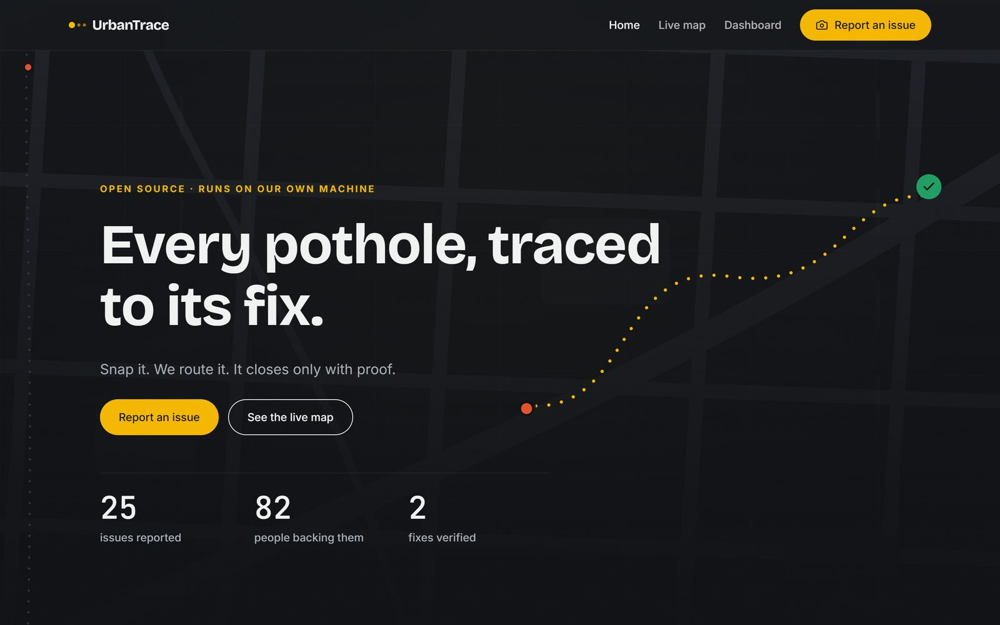
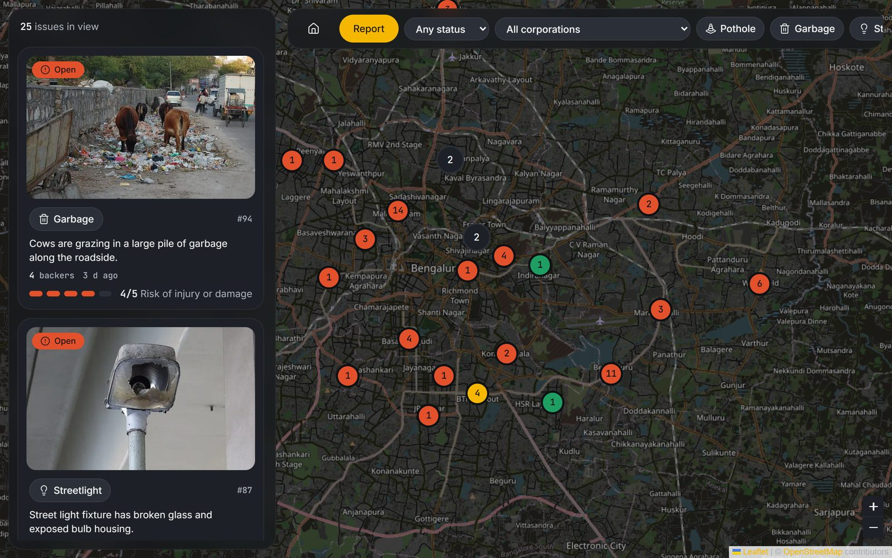
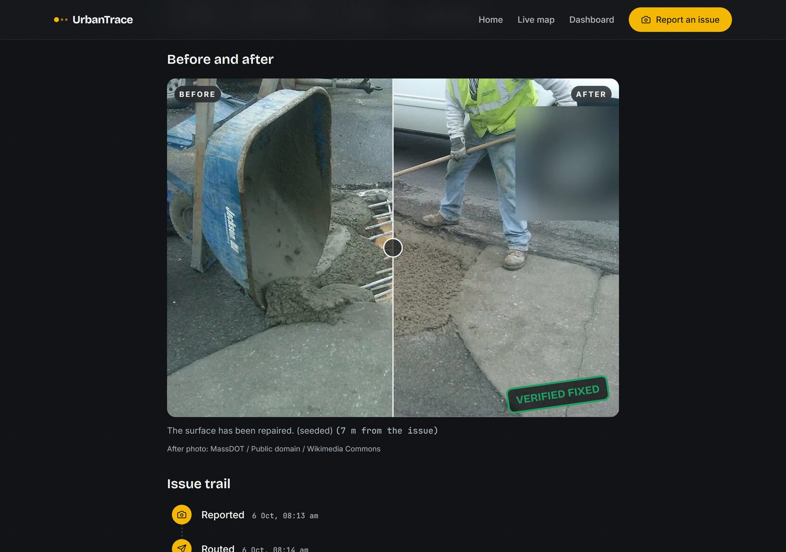
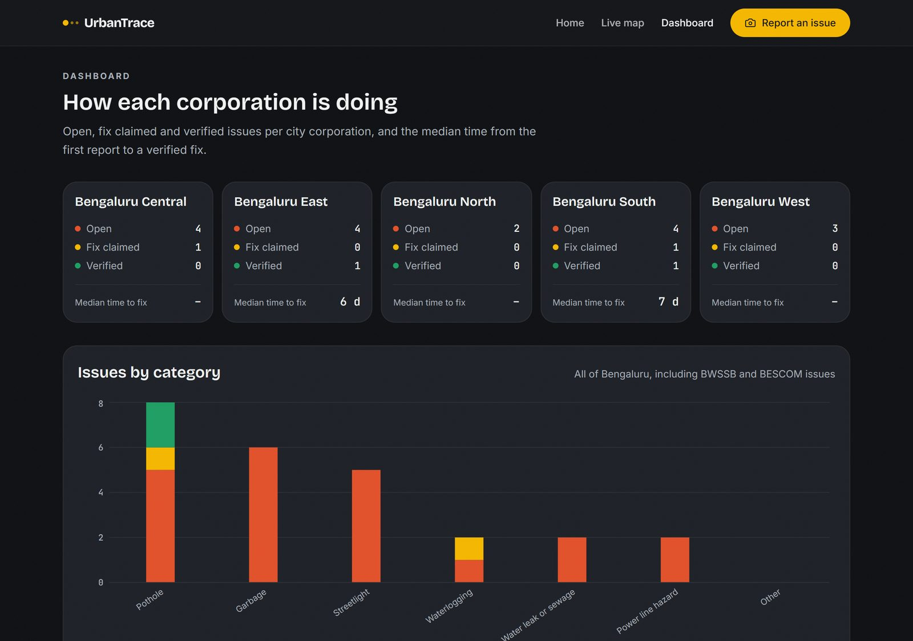
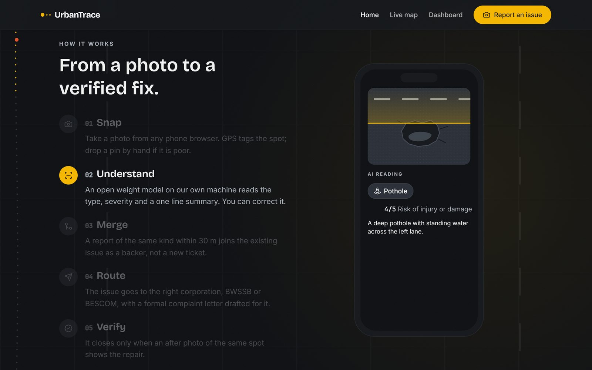
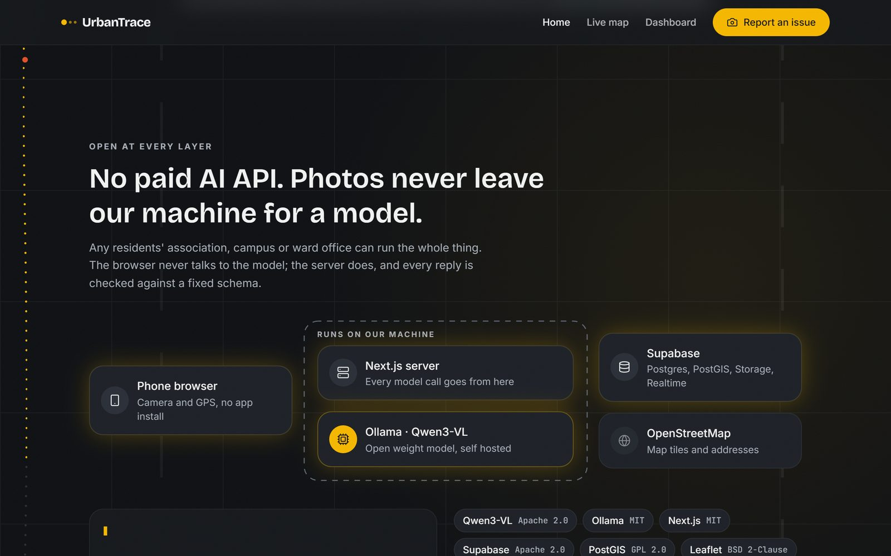
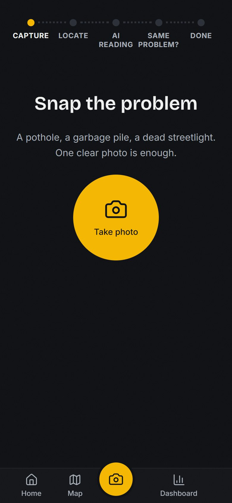
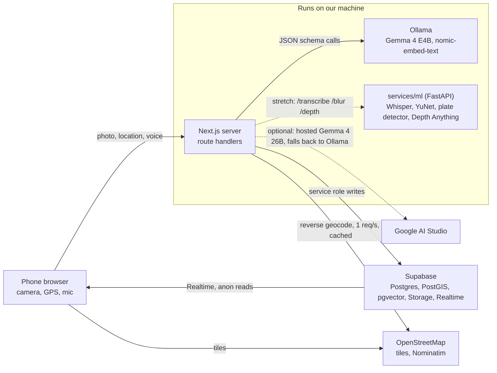

# UrbanTrace

**Every pothole, traced to its fix.** Snap it. We route it. It closes only with proof.

UrbanTrace is an open source civic intelligence app for Bengaluru. A resident reports with a photo, a ten second video or just their voice, in any language. Gemma reads the evidence and finds every problem in it, the app merges it with nearby reports of the same problem, works out the likely root cause across many reports, ranks it with an explainable priority, routes it to the right department with a compiled complaint, and closes it only when an after photo proves the repair.

Built by team **Code Not Found** for MLH Hacktoberfest Hack Day, Best Open-Source AI Project: Shourya Pratap Singh Chouhan, Daksh Bhatt, Shreya Singh Chouhan.



## Why it is different

- **Open weights, self hostable.** Every model is open weight. Gemma 4 runs in Ollama on our own machine; for speed the demo can use hosted Gemma 4 26B through Google AI Studio and falls back to the local model when that is unavailable. Any residents' association, campus or ward office can run UrbanTrace fully offline.
- **Root causes, not tickets.** Forty reports of one pothole become one issue with forty backers, and a flooded road, potholes and garbage near one blocked drain become one incident with its likely cause.
- **Explainable, not popular.** Priority is a transparent score of safety, people affected, accessibility, recurrence, evidence and rain, never upvotes alone.
- **Proof of fix.** An issue closes only when the after photo passes every check: same place, same scene, the problem gone, nothing new.

## Features

| # | Feature | What it does |
| --- | --- | --- |
| F1 | Photo report | Camera and GPS from any phone browser, no app install; drop a pin by hand if GPS is poor |
| F2 | AI reading | The model returns category, severity 1 to 5 and a one line summary as fixed schema JSON; the user can correct it |
| F3 | Public map | Every issue as a pin coloured by status with its backer count, clustered, filtered, live over Realtime |
| F4 | Duplicate merge | A report of the same kind within 30 m joins the existing issue as a backer |
| F5 | Routing | Category decides the agency (city corporation, BWSSB or BESCOM); boundaries decide the corporation |
| F6 | Complaint letter | The model drafts a formal letter to that body, ready to copy, print or email |
| F7 | Fix verification | An after photo of the same spot is compared with the original; GPS within 50 m is checked in code |
| F8 | Issue trail | Reported, merged, routed, fix claimed, verified, on one timeline |
| F9 | Voice reports | Speak the report in any language; Whisper transcribes it as context for the model |
| F10 | Ward dashboard | Open, fix claimed and verified counts and median time to fix per corporation and ward |
| F11 | Face and plate blurring | Faces and number plates are blurred before a photo is stored or read by a model |
| F12 | Embedding matching | Catches duplicates F4 misses because the model labelled them differently |
| F13 | Pothole depth | A rough shallow, moderate or deep class from relative depth, shown as estimated |
| F14 | Open dataset | Opt in photos, blurred, exported as a Hugging Face dataset under CC BY 4.0 |

### Civic intelligence

| Feature | What it does |
| --- | --- |
| AI civic investigator | A ten second video becomes one structured case: frames are read together with the voice note into a primary issue, secondary issues, severity, risks and the frames that prove it |
| Just talk | Report by voice alone; the model files the case from the transcript, with a summary in the reporter's language |
| Root cause graph | A civic causal graph (blocked drain → waterlogging → potholes, and so on) with noisy-OR inference picks the likely root cause of a cluster, with alternatives and reasons |
| Incident detection | Reports close in space and time are clustered (ST-DBSCAN with causal relatedness) into one incident |
| Emergency alerts | A burst of reports far above an area's usual rate (Poisson tail) raises a live civic alert on the map |
| Crowd truth | Confidence per fact (severity, location, recurrence, duration, cause) from independent reporters, media and repair history |
| Dynamic priority | An explainable 0 to 100 score with every factor shown; it updates as reports, rain and waiting time change |
| AI assignment | Department, sub-department, work type, crew, equipment and urgency from the case |
| Where does my complaint go | The journey from you to AI triage, department, zone officer, field team, site visit, repair, AI verification and your confirmation |
| Civic time machine | The history of one place: reports by month, rain, verified repairs and how long each lasted; a time slider on the city map |
| Recurrence detector | A problem that returns after a verified repair is flagged with how long the fix lasted |
| Repair history | Documented repairs and recurring problems per road segment in the authority console, without attributing fault |
| Multimodal proof of fix | Distance, capture time, scene similarity, the model's verdict and new problems, scored as verified, partial or failed; reporters confirm |
| What if we don't fix it | A model-traced chain of likely consequences from the facts of the case |
| Complaint compiler | One case file and a formal letter from every report, photo, frame and transcript |
| What's wrong around me | A plain words report on the civic health of the area around you |
| Accessibility mode | Accessibility hazards are rated in every report; a walking route planner avoids reported obstacles |
| Weather and civic reports | Rainfall from Open-Meteo against water and road reports: before and after heavy rain, and the correlation |
| Civic impact | What your reports changed: verified fixes, hazards reported, recurring problems surfaced. No points or rankings |
| Authority console | Officials work a queue ranked by priority and move cases stage by stage |

On the roadmap: email and SMS alerts on status changes, and official grievance portals where they publish an API.

| | |
| --- | --- |
|  |  |
|  |  |
|  |  |

The map, dashboard and issue screenshots show seeded demo data (`npm run seed:demo`) built from freely licensed stand-in photos; see [`bench/ATTRIBUTION.md`](bench/ATTRIBUTION.md).

## Architecture

The browser never talks to a model. Every AI call goes from a Next.js route handler to Gemma (hosted Gemma 4 26B when `GOOGLE_API_KEY` is set, otherwise Ollama on the same machine, which is also the fallback), and every reply is checked against a Zod schema, retried once, then handed to the user to fill in by hand. Supabase stores the results and pushes live updates to every open map. All writes go through the server with the service role key; the browser's anon key can only read.



Reporting is two calls on purpose: `analyze` cleans, blurs and stores the photo, reads it with the model and looks for duplicates; `submit` files it after the user has corrected the reading and confirmed any match. The 30 m merge is one database function, so two people reporting at once cannot create two issues.

| Route | Does | Features |
| --- | --- | --- |
| `POST /api/reports/analyze` | Clean, blur and store the photo, run the model, geocode, estimate depth, find duplicates | F1, F2, F4, F11, F12, F13 |
| `POST /api/reports/submit` | Merge or create through `submit_report`, route, then draft the letter and embed the summary | F4, F5, F6, F12 |
| `GET /api/issues?bbox=` | Issues in view as GeoJSON | F3 |
| `GET /api/issues/[id]` | One issue with its reports, verifications and trail | F8 |
| `POST /api/issues/[id]/letter` | Redraft the complaint letter | F6 |
| `POST /api/issues/[id]/verify` | After photo, GPS check, model verdict, status change | F7 |
| `POST /api/voice` | Voice note to text | F9 |
| `GET /api/stats` | City wide counters | F10 |
| `GET /api/incidents`, `/api/incidents/[id]` | Incidents and alerts with their root cause graph | Incidents, alerts |
| `POST /api/issues/[id]/scenario`, `/api/incidents/[id]/scenario` | What happens if it is not fixed | Scenario |
| `POST /api/issues/[id]/confirm`, `/api/issues/[id]/stage` | Reporter confirmation; authority stage changes | Proof of fix, journey |
| `GET /api/history`, `/api/zones/[cell]`, `/api/impact` | Place history, area report, a device's impact | Time machine, around me, impact |
| `GET /api/places`, `/api/route`, `/api/weather` | Place search, accessible walking routes, rain and reports | Accessibility, weather |
| `POST /api/intel/refresh`, `/api/authority` | Recompute priorities, incidents and alerts; authority sign in | Authority console |

The intelligence algorithms are plain TypeScript in `lib/intel/` (causal graph, clustering, alerts, priority, evidence, assignment, timeline, rain, journey, verification, routes) with unit tests in `tests/intel.test.ts`.

## Models and licences

| Model | Job | Licence |
| --- | --- | --- |
| Gemma 4 26B A4B (`gemma-4-26b-a4b-it`), hosted through Google AI Studio (optional) | Every model call when `GOOGLE_API_KEY` is set | Apache 2.0 |
| Gemma 4 E4B (`gemma4:e4b`), through Ollama | Read the evidence, explain incidents, compile the case, verify the fix; the local fallback | Apache 2.0 |
| Gemma 4 E2B (`gemma4:e2b`) | Fallback if E4B is too slow | Apache 2.0 |
| Qwen3-VL 8B Instruct (`qwen3-vl:8b-instruct`) | Benchmarked against Gemma; works as a drop in through `VISION_MODEL` | Apache 2.0 |
| nomic-embed-text | Summary embeddings for duplicate matching | Apache 2.0 |
| Whisper small, through faster-whisper | Voice to text | MIT |
| YuNet (OpenCV Zoo) | Face detection for blurring | MIT |
| YOLOv9-t plate detector (open-image-models) | Number plate detection for blurring | MIT |
| Depth Anything V2 Small (ONNX) | Relative depth for the pothole depth class | Apache 2.0 |

Main libraries: Next.js (MIT), React (MIT), Tailwind CSS (MIT), Motion (MIT), Lenis (MIT), MapLibre GL JS (BSD 3-Clause), deck.gl (MIT), Leaflet (BSD 2-Clause), Recharts (MIT), Lucide (ISC), Zod (MIT), sharp (Apache 2.0), exif-reader (MIT), Supabase JS (MIT), FastAPI (MIT), ONNX Runtime (MIT), OpenCV (Apache 2.0). Map data © OpenStreetMap contributors (ODbL), tiles by OpenFreeMap, walking routes by FOSSGIS OSRM, weather by Open-Meteo (CC BY 4.0).

## Benchmark

Every candidate model is measured on our own photos, not taken on reputation: 30 to 40 photos from around campus and nearby roads, every category, before and after pairs, and a few non issues (a selfie, a classroom) that must be rejected. `npm run benchmark` runs Gemma 4 E4B, Qwen3-VL 8B and Gemma 4 E2B through the same prompts, schemas and image preparation as the app and writes `bench/results.md`.

| Measure | How it is scored |
| --- | --- |
| Category accuracy | Model category equals the label; the highest wins, a tie goes to the faster model |
| Severity | Within 1 of the label |
| Non issue rejection | `is_civic_issue` false on every non issue |
| Verification accuracy | Verdict matches the label on the before and after pairs |
| Speed | Median seconds per call on our laptop (RTX 4060 Laptop, 8 GB) |

**Results** (18 October 2026, RTX 4060 Laptop GPU 8 GB, 47 photos and 6 before and after pairs):

| Measure | `gemma4:e4b` | `qwen3-vl:8b-instruct` | `gemma4:e2b` |
| --- | --- | --- | --- |
| Category accuracy | 75% (30/40) | 78% (31/40) | 70% (28/40) |
| Severity within 1 | 93% (37/40) | 95% (38/40) | 80% (32/40) |
| Non issue rejection | 71% (5/7) | 86% (6/7) | 71% (5/7) |
| Verification accuracy | 67% (4/6) | 83% (5/6) | 67% (4/6) |
| Median seconds per call | 5.9 | 3.3 | 3.7 |
| Invalid replies after retry | 0 | 0 | 0 |

**Gemma 4 E4B ships.** The hackathon centres on Gemma, so we run Gemma 4 E4B even though Qwen3-VL 8B edged it on this set: one photo more on category, and faster per call. Gemma reads severity and categories nearly as well, gave no invalid replies, and drafts the complaint letters. Switching models is one line in `.env.local` (`VISION_MODEL`), and the benchmark can be rerun on our own photos at any time.

These results come from stand-in photos: until our own campus photos are in, the test set is 47 freely licensed photos from Wikimedia Commons (credits in [`bench/ATTRIBUTION.md`](bench/ATTRIBUTION.md)), labelled by us. Most are not from Bengaluru, only two before and after pairs show a real repair, and our labels are one opinion. Broken streetlights were hard for every model (at most 3 of 5); water leaks and sewage tripped up both Gemma models (0 of 3) and power line hazards tripped up Qwen3-VL and Gemma 4 E2B (2 of 4). Garbage and waterlogging were near perfect for all three. The F12 similarity threshold stays at 0.3: the grouped photos in this set were all the same category, which cannot tell a duplicate described differently from a different problem.

## Setup

You need Node.js 24 or newer (the scripts and tests run TypeScript directly), [Ollama](https://ollama.com), a [Supabase](https://supabase.com) project, and for the stretch features Python 3.12 or newer.

```bash
# 1. App
npm install
cp .env.example .env.local        # then fill in the Supabase keys, a contact email for Nominatim, AUTHORITY_PASSCODE,
                                  # and optionally GOOGLE_API_KEY for hosted Gemma 4 26B

# 2. Models
ollama pull gemma4:e4b            # main model
ollama pull gemma4:e2b            # fallback
ollama pull nomic-embed-text      # F12
ollama pull qwen3-vl:8b-instruct  # benchmark only

# 3. Database: in the Supabase SQL editor, run supabase/migrations/0001 to 0007 in order.
#    They enable PostGIS and pgvector, create the tables with row level security, the photos
#    bucket, the merge function, the read functions and views, and the intelligence tables.

# 4. Stretch model service (F9, F11, F13). Optional: leave ML_SERVICE_URL empty to run without it.
cd services/ml
python -m venv .venv
.venv/Scripts/pip install -r requirements.txt     # macOS and Linux: .venv/bin/pip
.venv/Scripts/python -m uvicorn app:app --port 8001
cd ../..

# 5. Run
npm run dev                                       # http://localhost:3000

# 6. HTTPS for phones, so the camera and GPS work
cloudflared tunnel --url http://localhost:3000
```

The first photo after starting Ollama loads the model, which can take a couple of minutes on a laptop; send one photo before a demo to warm it up. When `ML_SERVICE_URL` is set, photos are refused rather than stored unblurred if the service is down.

### Scripts

| Command | Does |
| --- | --- |
| `npm test` | Unit tests: routing, the verification rules, the Zod schemas against bad model output, and the intelligence algorithms |
| `npm run test:db` | Database tests against `submit_report` on the Supabase project in `.env.local`; they clean up after themselves |
| `npm run benchmark` | The model benchmark above |
| `npm run seed:demo` | About 25 demo issues across Bengaluru from the benchmark photos in mixed statuses, plus a drainage incident in Koramangala, a flooding alert in Bellandur and a recurring pothole in HSR Layout; `-- --clear` removes them. They are seeded, and we say so in the pitch |
| `npm run seed:boundaries -- --corporations <file> --wards <file>` | Load corporation and ward boundaries from GeoJSON; until then users pick their corporation from a list |
| `npm run export-dataset` | Export the consented, blurred photos as a Hugging Face image folder in `dataset/` |
| `npm run typecheck`, `npm run lint` | TypeScript and ESLint |

## Privacy and safety

- Photos are re-encoded with sharp before storage, which drops EXIF data including the phone's own GPS tag.
- With the model service on, faces and number plates are blurred before a photo is stored, shown or read by a model.
- Each browser gets an anonymous random id so one person cannot back the same issue twice. There are no accounts.
- Row level security is on for every table. The anon key can only read issues, reports, verifications and the trail; every write runs on the server.
- The open dataset only includes photos whose reporter ticked the consent box, with coordinates rounded to about 100 m and no device ids or voice notes.

## Licence

MIT, see [LICENSE](LICENSE). The open dataset is published under CC BY 4.0.
